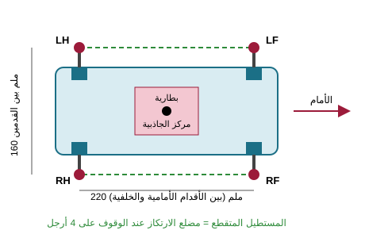
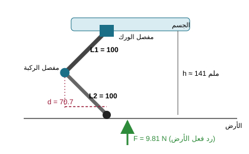
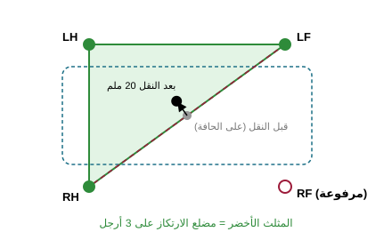
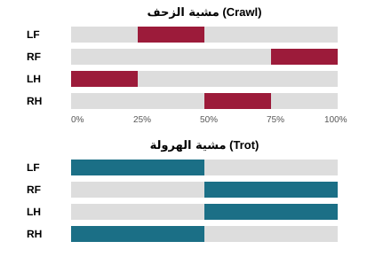

<div dir="rtl">

# التصميم الميكانيكي الأولي لكلب روبوتي بسيط

مهمة مسار الهندسة الميكانيكية – اللقاء الأول (الأسبوع الرابع).

**المطلوب:** إنشاء التصميم الميكانيكي الأولي لكلب روبوتي بسيط مع التركيز على: شكل الجسم والهيكل، تصميم الأرجل، عدد المفاصل ودرجات الحرية، اختيار المحركات، حساب عزم مبدئي لأحد المفاصل، الثبات ومركز الجاذبية، طريقة المشي المقترحة، والمشاكل الميكانيكية المتوقعة.

> التقرير الكامل مع كل الحسابات والجداول في الملف [`robot-dog-design-report.html`](robot-dog-design-report.html). افتحه في المتصفح، ويمكن حفظه PDF عن طريق Ctrl+P.

## ملخص التصميم

| البند | القيمة المختارة |
|---|---|
| نوع الروبوت | رباعي الأرجل (Quadruped) |
| أبعاد الجسم | 280 × 110 × 70 ملم |
| طول الفخذ / الساق | 100 ملم / 100 ملم |
| ارتفاع الوقوف | ≈ 141 ملم |
| درجات الحرية | 12 (3 لكل رجل) |
| المحركات | 12 سيرفو DS3218 (≈ 20 كغ·سم) |
| الكتلة التصميمية | 2.0 كغ |
| البطارية | LiPo 2S 2200 mAh + منظم 6 فولت / 15 أمبير |
| طريقة المشي | الزحف (Crawl) ثم الهرولة (Trot) |

## 1) شكل الجسم والهيكل

صندوق مستطيل من ألواح ألمنيوم جانبية 2 ملم وقطع مطبوعة PETG. محركات الورك في الزوايا الأربع، والبطارية في المنتصف من الأسفل لخفض مركز الجاذبية.



## 2) تصميم الأرجل

كل رجل: حامل كتف (إزاحة 50 ملم) + فخذ 100 ملم + ساق 100 ملم + قدم مطاطية كروية. الركبة تنثني للخلف، والقدم تكون تحت الورك في وضع الوقوف.



## 3) المفاصل ودرجات الحرية

| المفصل | الوظيفة | المدى |
|---|---|---|
| الورك الجانبي (Hip Roll) | إبعاد الرجل للجانب والتوازن | ±30° |
| الورك الأمامي (Hip Pitch) | تحريك الرجل أمام/خلف | −90° إلى +60° |
| الركبة (Knee) | رفع القدم وتغيير الارتفاع | 30° إلى 150° |

3 مفاصل × 4 أرجل = **12 درجة حرية**.

## 4) اختيار المحركات

سيرفو **DS3218**: تروس معدنية، 19 كغ·سم عند 5 فولت و21.5 كغ·سم عند 6.8 فولت. المحرك MG996R (≈ 11 كغ·سم) لا يكفي للركبة.

## 5) حساب عزم مفصل الركبة

<div dir="ltr">

```
W = m × g = 2.0 × 9.81 = 19.62 N
F (per leg, trot = 2 legs) = 19.62 / 2 = 9.81 N

Normal stance:  d = 100 × sin45° = 70.7 mm
                τ = 9.81 × 0.0707 = 0.694 N·m ≈ 7.1 kg·cm
Worst case:     d = 100 mm
                τ = 9.81 × 0.100 = 0.981 N·m ≈ 10.0 kg·cm

Safety factor 2 → τ_required ≈ 20 kg·cm  → DS3218 ✔
```

</div>

## 6) الثبات ومركز الجاذبية

- الروبوت مستقر إذا وقع مركز الجاذبية داخل مضلع الارتكاز (الشكل الذي تكوّنه الأقدام على الأرض).
- زاوية الانقلاب: ≈ 28.9° جانبياً و ≈ 37.2° أمامياً.
- عند رفع رجل واحدة يقع مركز الجاذبية على حافة المثلث، لذلك يُنقل الجسم ≈ 20 ملم داخل المثلث قبل رفع الرجل.



## 7) طريقة المشي

- **الزحف (Crawl):** رجل واحدة كل مرة بالترتيب LH ← LF ← RH ← RF، مستقر دائماً. السرعة ≈ 0.05 م/ث.
- **الهرولة (Trot):** كل رجلين قطريتين معاً، أسرع (≈ 0.12 م/ث) وتحتاج حساس ميلان IMU.



## 8) المشاكل الميكانيكية المتوقعة

| المشكلة | الحل |
|---|---|
| سخونة محركات الركب | معامل أمان 2 وتقليل الكتلة |
| حمل جانبي على عمود السيرفو | رولمان بلي في الجهة المقابلة للمحرك |
| انزلاق ذراع السيرفو | أذرع ألمنيوم مثبتة ببراغي |
| خلوص التروس | تروس معدنية ومعايرة برمجية |
| انزلاق الأقدام | أقدام مطاطية |
| انثناء الأرجل والتواء الجسم | ألواح ألمنيوم وتعبئة طباعة 40% فأكثر |
| ارتخاء البراغي | صواميل قفل أو Threadlocker |
| انقطاع الطاقة عند تحرك كل المحركات | UBEC بتيار عالٍ وفصل تغذية المتحكم |

القائمة الكاملة (12 مشكلة مع الأسباب) موجودة في التقرير.

## محتويات المستودع

| الملف | الوصف |
|---|---|
| `robot-dog-design-report.html` | التقرير الكامل |
| `figures/` | الرسومات التوضيحية الأربعة (SVG) |

</div>